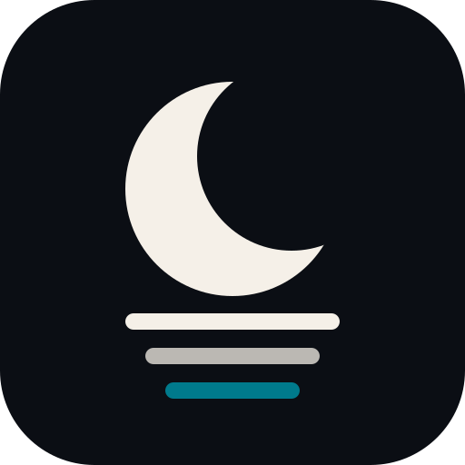

# Dreaming Wiki

<p align="center">
  
</p>

> A second brain that maintains itself while you sleep.

Karpathy's LLM Wiki is a folder of markdown plus an LLM that writes and maintains it, instead of re-deriving answers from raw documents on every query. The folder is the easy part. Wikis die because nobody maintains them: sources go stale, notes contradict each other, and the index rots.

Dreaming Wiki packages the method plus the thing most implementations skip: a **nightly dreaming pass**. Every night the agent reads the day, consolidates what is durable, lints the vault and leaves a log. Every Sunday it writes a digest of the week. The wiki is alive even when you are not.

## How it works

Anti-RAG. Instead of re-deriving an answer from raw documents on every query, the wiki holds a *precomputed* synthesis: one note per topic, linked to its sources, kept consistent. The human curates sources, directs and asks questions. The agent does all the bookkeeping.

```
                 ┌─────────────────────────────────────┐
                 │            THE VAULT               │
 capture ──────▶ │ sources/   (raw, dated, immutable) │
                 │      │                             │
                 │      ▼                             │
                 │ knowledge/   projects/   weekly/   │
                 │ Home.md (index)  journal/ (log)    │
                 └──────────────┬──────────────────────┘
                                │ read nightly
                  dreaming (02:00)  ─▶ consolidate + lint + log
                  digest (Sunday)   ─▶ weekly/ + short summary
```

The three layers from Karpathy's gist, plus the maintenance loop:

1. **Raw sources** — immutable captures. The audit layer: every claim in the wiki traces back here.
2. **The wiki** — precomputed synthesis in linked markdown. The agent writes it, you read and curate it.
3. **The schema** — naming, frontmatter and link conventions that turn the agent into a disciplined maintainer.

On top: **dreaming** (nightly consolidation + lint) and the **weekly digest**.

## What the nightly pass does

1. Finds new material since the last pass (your agent sessions, the journal)
2. Consolidates: durable lessons to `knowledge/`, state changes to `projects/`
3. Lints: broken links, orphan notes, contradictions, unprocessed sources
4. Leaves a `## Dreaming` entry in today's journal (1-5 lines)

Sundays add the digest: what was done, decisions and why, learnings, next steps.

## Install

**Hermes Agent**

```bash
git clone https://github.com/JMBargueno/dreaming-wiki ~/.hermes/skills/dreaming-wiki
```

**Claude Code**

```bash
git clone https://github.com/JMBargueno/dreaming-wiki ~/.claude/skills/dreaming-wiki
```

Then tell the agent: *Set up my dreaming wiki.*

Requirements: an LLM agent with file access, and a scheduler (or run the prompts manually). Obsidian is optional but recommended: it is the IDE for the vault (wikilinks, graph view, backlinks). The agent only needs plain files.

## Ground rules

- `sources/` is immutable: captures are never edited, only re-captured.
- Contradictions are surfaced, never silently resolved: an explicit "Contradiction:" line plus a journal entry, and the human decides.
- No invented facts: every consolidation is grounded in a session, a journal entry or a source.
- No secrets in the vault.
- Digests summarize; they never duplicate the journal.

## Credits

- The method: [Karpathy's LLM Wiki gist](https://gist.github.com/karpathy/442a6bf555914893e9891c11519de94f) (April 2026)
- Explainer: askglitch, "Build a Second Brain"

Built and run in production on a Hermes Agent deployment (nightly dreaming + weekly digest, E2EE-synced Obsidian vault).

## License

MIT
